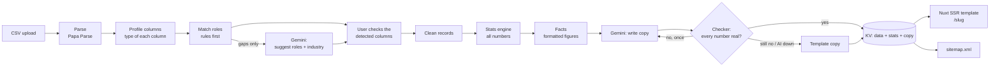

# CSV to SEO blog

Turns a company dataset (a CSV with one company per row) into a server-rendered, search-optimised ranking page, with copy written by an AI model and every number checked in code.

**Live:** https://csv-to-seo-blog.edward-radford.workers.dev
**Example page:** [Top 100 Seed-Stage Fintech Companies in the UK](https://csv-to-seo-blog.edward-radford.workers.dev/top-100-seed-stage-fintech-companies-in-the-uk-2026)

Built for the Beauhurst Graduate/Junior Web Developer technical assessment by Edward Radford.

To try it with no setup, open the live site, choose **Generate a report**, and upload any CSV of companies. The home page has five sample files to download.

## How it works



1. **Upload, step 1** (`POST /api/analyse`). The CSV is parsed, and each column is profiled from its values (money, number, year, size band, URL, list, category, text). Rules match columns to roles (name, rank, amount, region, stage, size, description, website, tags, founded) using the header and the type. Gemini is asked only about columns the rules couldn't place, and it can only fill an empty role with a column of a suitable type. It also suggests the industry name.
2. **The user checks the mapping.** The upload page shows what was detected and where each guess came from (header, values or AI), and any of it can be changed. A wrong guess gets fixed before any copy is written.
3. **Generate** (`POST /api/generate`). Rows become clean company records. Then `shared/stats.ts` calculates every figure on the page: totals, median, concentration, regions, stages, sizes, categories and founding years.
4. **Copy.** The AI is given those figures as finished text ("The top 10 companies account for 33% of the total") and writes the meta description, intro, overview, key findings, locations, outlook and FAQ, in a fixed JSON format. A checker then extracts every number from the copy. It rejects any number that isn't a correctly rounded version of a calculated figure ("£30m" passes for £30.3m; "£31m" fails), along with markdown and wrong lengths. A failed answer is retried once with the list of problems. If it fails again, or the AI is down, template copy built from the same figures is used. The page says which happened.
5. **Storage.** The page record keeps the three layers separate: `data` (clean dataset), `stats`, and `content` (copy, source, model, checker notes). The Vue template is the presentation layer. Nothing is rebuilt: `/[slug]` renders any stored page on request.

## SEO

- **Server-rendered:** the full article, table and charts are in the HTML before any JavaScript runs. Table sorting uses links, so it works without JavaScript too.
- **Title formula, matching Beauhurst's own lists:** `Top {N} {Stage} {Industry} Companies in {Place} | {Year}`. It's fixed in code, not written by the AI, so every page targets the same search query.
- **Per-page tags:** meta description, canonical, Open Graph, Twitter card, `en-GB`, and `robots` (an optional noindex box on upload).
- **JSON-LD:** `Article`, `BreadcrumbList`, and an `ItemList` of every company as an `Organization` (website, location, size, stage, amount raised).
- **Crawling:** `/sitemap.xml` is built from the page index on every request, so new pages are discoverable straight away. `/robots.txt` points to it and blocks `/api/` and `/upload`.
- **Linking:** an index page links every report, and each report links to the others.
- **Structure:** one H1 and a clear H2 order (overview, key findings, locations, ranking, what to watch, FAQ, methodology).

## Tools

| Tool | Why |
| --- | --- |
| Nuxt 4 (Vue 3) | Required. Server-side rendering and per-page head management (`useSeoMeta`). |
| Cloudflare Workers (free plan) | Hosting. Server-renders every request, close to the visitor. |
| Cloudflare KV | Stores generated pages. Accessed through Nitro storage, so local runs use files instead. |
| Cloudflare rate limiting binding | 10 requests a minute per IP on the endpoints that cost money. |
| Google Gemini API (free tier) | `gemini-3.5-flash` for copy and column hints; `gemini-flash-lite-latest` as the fallback. |
| Papa Parse | CSV parsing, including delimiter detection (comma, semicolon, tab). |
| Vitest | Unit tests for parsing, detection, stats and the copy checker. |
| Inter (via Fontsource) | Self-hosted font, so there are no third-party requests. |

## Run it locally

Needs Node 20 or later.

```bash
git clone https://github.com/EdwardRadford/csv-to-seo-blog.git
cd csv-to-seo-blog
npm install
cp .env.example .env    # then add a free Gemini key from https://aistudio.google.com
npm run dev             # http://localhost:3000
```

Without a key it still works: every page gets template copy.

```bash
npm test                          # unit tests
LIVE=1 npx vitest run test/live   # optional: real Gemini calls (uses your quota)
node scripts/make-samples.mjs     # rebuild the synthetic sample CSVs
```

## Configuration

| Setting | Where | Notes |
| --- | --- | --- |
| `NUXT_GEMINI_API_KEY` | `.env` locally; `wrangler secret put NUXT_GEMINI_API_KEY` in production | Server-side only; never sent to the browser. |
| `NUXT_PUBLIC_SITE_URL` | `nuxt.config.ts` default | Used for canonical URLs, JSON-LD and the sitemap. |
| `NUXT_PROTECTED_SLUGS` | `nuxt.config.ts` default | Pages that can be regenerated but not deleted (the fintech example). |
| KV namespace, rate limit | `wrangler.jsonc` | |

Deploy: `npm run build && npx wrangler deploy`.

## Project layout

```
shared/          Pure TypeScript, used by the server and the tests
  csv/           parse, profile, roles, normalise, values
  stats.ts       every figure on a page, and the facts given to the AI
  copy.ts        prompt, JSON schema, number checker, template copy, title
  page.ts        the stored page record
server/
  api/           analyse, generate, pages (list, get, delete, regenerate)
  routes/        sitemap.xml, robots.txt
  utils/         gemini client, AI steps, pipeline, storage, guards
app/
  pages/         index, upload, [slug] (the report template)
  components/    RankingTable, BarList, ConcentrationChart
samples/         the real fintech CSV and four synthetic ones
test/            unit tests and opt-in live tests
```

## Key decisions

- **Numbers in code, words from the AI.** LLMs are good at prose and bad at arithmetic. Keeping every figure out of the model's hands, then checking its output, means a page can't publish a number that isn't in the data.
- **Rules before AI for column mapping.** Header and type rules are instant, free and predictable, and they handle every sample file. The AI is only asked about leftovers, and the user confirms the result, so one wrong guess can't spoil a page.
- **A fixed title formula.** It keeps titles consistent and targeted, and stops the AI drifting into clickbait.
- **KV over a database.** Each page is read whole, by its slug, so a key-value store fits. The trade-offs: KV is eventually consistent (a new page can take a few seconds to appear in other regions), and the page index is a single key rewritten on each save. That's fine for a demo, but not for thousands of pages (see Limitations).
- **Template fallback.** The free Gemini tier sometimes returns 503 under load. The demo must never fail, so the same model is retried once after 1.5 seconds, then a second model is tried, then template copy is used. The methodology section says which one produced the copy.

## Limitations

- The checker verifies numbers, not meaning. It can't catch a correct figure attached to the wrong claim. The prompt guards against that, but code doesn't.
- The AI is never shown the full dataset, only the top 10 companies and the computed facts, so the copy can't say anything about the rest of the list beyond the stats.
- The page index is one KV key, so two uploads at the same moment could race. A database (D1) or Durable Object would fix this at scale.
- The free Gemini tier has rate limits. A soft daily cap (150 AI generations) protects the quota, and after that pages get template copy.
- Uploaded files aren't kept: only the cleaned data is stored. Values are always shown as text, and the app never exports CSV, so spreadsheet formula injection doesn't apply.
- Anyone can upload and delete (except the protected example). A real deployment would put generation behind a login.
